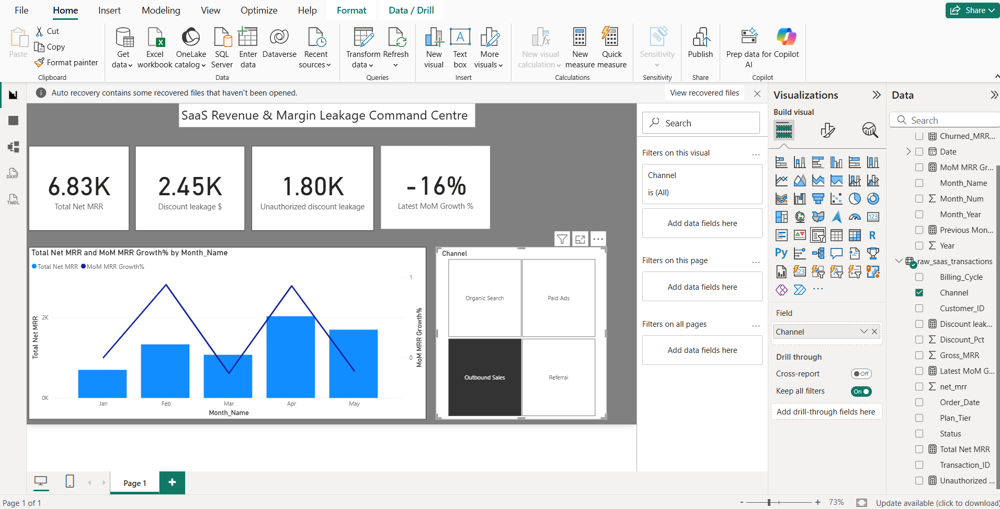

# SaaS-Revenue-Margin-Leakage-Command-Centre
# 📊 Automated SaaS Revenue & Margin Leakage Command Centre



> **Executive Summary:** An end-to-end automated Business Intelligence and Revenue Operations (RevOps) pipeline built to eliminate manual spreadsheet reporting, standardize multi-channel SaaS transactions, and isolate unauthorized discount margin leakage without custom code.

---

## 🎯 The Business Problem
Lean, fast-growing SaaS startups frequently track subscription transactions across fragmented CSV exports and billing logs. This creates three costly blind spots for founders and finance teams:
1. **Dirty Transactional Data:** Duplicate order IDs, inconsistent international date formats (`DD/MM/YYYY` vs. `YYYY-MM-DD`), negative refund glitches, and unstandardized channel names distort top-line reporting.
2. **Silent Margin Leakage:** Sales representatives issuing unapproved discounts (`>20%` policy threshold) silently erode net unit economics.
3. **Manual Reporting Overhead:** Finance teams spend hours every week manually cleaning spreadsheets instead of acting on real-time Month-over-Month (MoM) growth and churn signals.

---

## 🏗️ System Architecture & Automation Stack

```text
[Raw Multi-Channel CSV / SQL Logs] 
       │
       ▼  (Automated ETL: Deduplication, Locale Date Parsing, Null/Refund Filtering)
[Power Query / SQL Views] 
       │
       ▼  (Star Schema: 1-to-Many Relationship with Dynamic DAX Calendar)
[Relational Data Model (Power BI & Excel Power Pivot)] 
       │
       ▼  (Time-Intelligence DAX & Policy Threshold Logic)
[Dark-Mode Executive Command Centre + Actionable Sales Audit Table]
```

* **SQL (`saas_revenue_pipeline.sql`):** Production-ready SQL view using CTEs (`WITH`), `DISTINCT` deduplication, string normalization, and conditional aggregation (`CASE WHEN`) to flag margin leakage at the database layer.
* **Power Query (M Engine):** Zero-touch ETL pipeline that automatically ingests raw CSV drops, parses mixed UK/US date locales, strips corrupt/negative rows, and computes `Net_MRR`.
* **Data Modeling & Excel (`Executive_Financial_Model.xlsx`):** Star Schema connecting a continuous `Dim_Date` calendar table to the cleaned fact table, paired with an Excel Power Pivot model featuring conditional data bars and slicers.
* **Power BI & DAX:** Custom time-intelligence measures (`PREVIOUSMONTH`, `DIVIDE`, `CALCULATE`, `SUMX`, `VAR/RETURN`) powering an interactive dark-slate executive interface.

---

## 💡 Key Executive Insights Uncovered
* **Automated Data Hygiene:** Stripped duplicate orders (`TXN-1004`, `TXN-1015`, `TXN-1054`) and corrupt `$0` / negative refund rows automatically upon refresh.
* **Unauthorized Margin Leakage Detection:** Isolated every transaction discounted above the **20% company cap**, pinpointing **Outbound Sales** as the primary driver of margin erosion while confirming `$0` leakage across **Organic Search** and **Referral**.
* **Executive Trajectory:** Built dynamic MoM Net MRR growth tracking (`-7%` May vs. April benchmark) and Churned MRR isolation across acquisition channels (*Paid Ads*, *Outbound Sales*, *Organic Search*, *Referral*).

---

## 🎥 Interactive 1-Minute Walkthrough
https://github.com

*(Watch how clicking any acquisition channel tile—Paid Ads, Outbound Sales, Organic Search—dynamically recalculates Net MRR, MoM Growth, and High-Risk Discount deals).*

---

## 📂 Repository Structure

| File | Description |
| :--- | :--- |
| `SaaS_Command_Centre.pbix` | Complete Power BI Desktop file containing Power Query ETL, Star Schema, DAX measures, and dark-mode UI. |
| `saas_revenue_pipeline.sql` | PostgreSQL/MySQL-compatible view replicating the cleaning and margin leakage logic in SQL. |
| `Executive_Financial_Model.xlsx` | Excel Data Model (Power Pivot) with PivotTables, slicers, and conditional formatting data bars. |
| `raw_saas_transactions.csv` | Raw synthetic SaaS dataset containing intentional data anomalies for pipeline validation. |

---

## 🚀 How to Run Locally
1. Download `SaaS_Command_Centre.pbix` and `raw_saas_transactions.csv`.
2. Open the `.pbix` file in **Power BI Desktop** (Free).
3. Go to **Transform Data -> Data source settings** -> Point the CSV path to your local `raw_saas_transactions.csv` and click **Refresh** to watch the automated cleaning pipeline execute.

---

### 👤 Built By
**Murthy Narendra** — *Analytics & RevOps Automation Specialist*  
[GitHub Portfolio](https://github.com)
